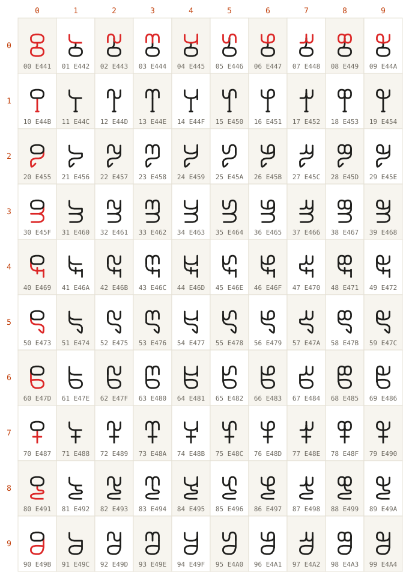
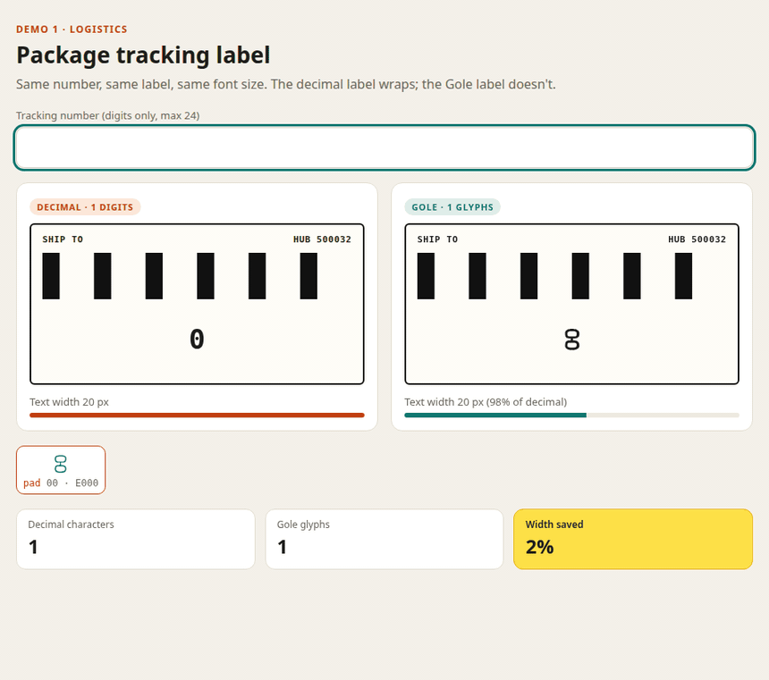

<p align="center">
  <picture>
    
  </picture>
</p>

<p align="center"><b>Gole Number System is a base-100 number system. </b><br/>
Decimal has ten symbols, 0 to 9, and each one stands for one digit. Gole has a hundred symbols, one for every value from 0 to 99, so each Gole symbol stands for a pair of decimal digits.</p>

<p align="center">
  <a href="https://www.npmjs.com/package/@esetu-solutions/gole-number-system-fonts"></a>
  <a href="https://esetu.in/gole-number-system/licence"></a>
  <a href="https://esetu-solutions.github.io/gole-number-system-fonts/"></a>
  
</p>

<p align="center">
  <a href="#quick-start">Quickstart</a> ·
  <a href="https://esetu-solutions.github.io/gole-number-system-fonts/">Docs</a> ·
  <a href="#quick-demo---logistics-label">Demo</a> ·
  <a href="#implementation-guide">Implementation guide</a>
</p>

# Gole Number System - Fonts

A number written in Gole needs **half as many symbols** as the same number in decimal. For the background and purpose of the system, see [What is the Gole number system?](https://esetu.in/gole-number-system/what-is-gole-number-system)

This repository has everything you need to show Gole numbers on screen and on paper:

- The GoleStandard typeface in two builds, **Ligature** and **PUA**, so you can pick the one that suits your app
- Conversion code for JavaScript and Python
- Guides for the web, React, Python, images, PDF, spreadsheets, mobile and desktop apps
- A live comparison page, and a logistics demo with its complete source code

## Contents

1. [The Gole number system](#the-gole-number-system): [Symbols](#the-symbols) · [Whole numbers](#writing-whole-numbers) · [Fractions](#writing-fractions) · [Why base 100](#why-base-100)
2. [Quick start](#quick-start)
3. [Choose a font build](#choose-a-font-build)
4. [Gole in software](#gole-in-software): [Ligature build](#ligature-build) · [PUA build](#pua-build)
5. [Rules you cannot skip](#rules-you-cannot-skip)
6. [Implementation guide](#implementation-guide): [HTML/CSS](#htmlcss) · [JavaScript](#javascript) · [React](#react) · [Python](#python) · [Images](#rendering-to-images) · [PDF](#pdf) · [Spreadsheets](#spreadsheets) · [Mobile](#mobile) · [Desktop apps](#desktop-apps)
7. [Quick demo: logistics label](#quick-demo---logistics-label)
8. [Licence](#licence)

---

## The Gole number system

This section is a short summary for implementers. For the full concepts, see [Fundamentals of the Gole number system](https://esetu.in/gole-knowledge-base/fundamentals-of-the-gole-number-system).

### The symbols

Every Gole symbol has two parts:

- a **main** shape, for the first digit of the pair (the tens)
- a **modifier** stroke, for the second digit (the units)

Ten main shapes and ten modifiers give 10 × 10 = 100 symbols. The symbol for *n* is main ⌊*n* / 10⌋ with modifier *n* mod 10. For example, 35 is main 3 with modifier 5.



Rows are the main digit and columns are the modifier digit. Each cell shows the symbol's value and its character code in the [PUA build](#pua-build). In the [Ligature build](#ligature-build) you just type the value's two digits. The red parts mark the zero symbols: in the first row (main 0) the modifier is red, and in the first column (modifier 0) the main shape is red.

To learn how to say Gole numbers aloud, see [How to pronounce Gole numbers](https://esetu.in/gole-knowledge-base/how-to-pronounce-gole-numbers).

### Writing whole numbers

1. If the number has an odd number of digits, put one `0` in **front** (pad on the left). Fractions are padded differently; see below.
2. Read the digits two at a time from the left.
3. Write each pair as the Gole symbol for its value.

| Decimal | Pairs | Gole symbol | Gole symbols count |
|---|---|---|---|
| `7` | `[07]` |  | 1 |
| `35` | `[35]` |  | 1 |
| `123` | `[01][23]` |  | 2 |
| `2026` | `[20][26]` |  | 2 |
| `1,00,000` | `[10][00][00]` |  | 3 |
| `1863486135148634156` | `[01][86][34][86][13][51][48][63][41][56]` |  | 10 |

A number with *n* digits takes **⌈*n* / 2⌉** Gole symbols. The leading `0` doesn't change the value, just as `07` is still seven.

### Writing fractions

The whole part is padded on the left, as above. The fractional part is padded on the **right**, so its value stays the same: `.5` is `.50`.

| Decimal | Pairs | Gole symbol |
|---|---|---|
| `144.00` | `[01][44].[00]` | . |
| `12.5` | `[12].[50]` | . |
| `0.375` | `[00].[37][50]` | . |

Gole only replaces digits. The decimal point, separators, signs and units stay as they are, and each run of digits is written separately:

| Decimal | Gole |
|---|---|
| `20/11/2026` | `[20]/[11]/[20][26]` |
| `12:05:09` | `[12]:[05]:[09]` |
| `−4.5 °C` | `−[04].[50] °C` |

For a step-by-step guide with more examples, see [How to write Gole numbers](https://esetu.in/gole-knowledge-base/how-to-write-gole-numbers). To convert a number without writing any code, use the online [Decimal to Gole converter](https://esetu.in/experience-in-gole/decimal-to-gole-conversion).

### Why base 100

- **Half the symbols.** Long identifiers, prices, gauge labels and table columns take half the space. The demos below measure the saving live.
- **Conversion is just grouping.** 100 is a power of 10, so converting between decimal and Gole needs no arithmetic. You only split the digits into pairs or join the pairs back together.
- **Two-digit fields become single symbols.** Hours, minutes, seconds, days, months and percentages up to 99 are each one Gole symbol.

---

## Quick start

Open [`docs/index.html`](docs/index.html) in a browser. Type any number and the page shows it in decimal and in Gole side by side, with three savings measured live:

- **Symbols:** digits against Gole glyphs, always about half.
- **Width:** how much narrower the Gole text is at the same font size.
- **Ink:** how much less printed area the Gole text covers.

A table of everyday numbers (dates, times, prices, invoice and tracking numbers) shows the same comparison. Two more sections turn those savings into impact:

- **Paper and sustainability:** set how many number-heavy pages you print and how much of each page is numbers, and see the pages, trees, water, CO₂e and toner saved. The conversion factors are editable.
- **Computing:** glyphs to lay out, screen width, lit pixels and bytes, each shown as a percentage of decimal, including the extra storage the PUA build costs.

The page uses the [Ligature build](#ligature-build) and loads it from `../fonts/Ligature/`, so keep `docs/` and `fonts/` side by side, as in this package or a clone of the repo.

The conversion itself is a few lines: pad the whole part on the left and the fraction on the right. The page's "How the conversion works" section shows the code, and [Gole in software](#gole-in-software) explains both builds.

To check your own output, compare it with the [Decimal to Gole converter](https://esetu.in/experience-in-gole/decimal-to-gole-conversion) on the eSetu website.

---

## Choose a font build

GoleStandard comes in two builds. They draw identical Gole symbols; they differ in what the text underneath is.

| | **Ligature build** | **PUA build** |
|---|---|---|
| Folder | [`fonts/Ligature/`](fonts/Ligature/) | [`fonts/PUA/`](fonts/PUA/) |
| Files | `GoleStandard.ttf` · `.woff2` · `.woff` · `.css` | `GoleStandard_PUA.ttf` · `.woff2` · `.woff` · `.css` |
| The text holds | Ordinary digits, padded to whole pairs: `0123` | One Private Use Area character per pair: U+E442 U+E458 |
| How a symbol appears | The font joins each pair of digits into one Gole glyph (an OpenType ligature) | The font maps each character to one Gole glyph |
| Copy-paste | **Copies as the decimal number.** Selecting `[01][23]` copies `0123`, so the paste is readable digits in any app, with or without the font: a built-in fallback | Copies the Private Use Area characters, which show as empty boxes in any app without the PUA build |
| Search, `Number()`, screen readers | Work, because the text is still digits | Get Private Use Area characters; keep the decimal value alongside |
| Needs | An app or library that applies OpenType ligatures | Nothing beyond basic TrueType support |
| Without the font | Plain digits are shown | Empty boxes (□) are shown |

**Start with the Ligature build.** The text stays a real number, so copy-paste, data, search and accessibility keep working. Use the **PUA build** where ligatures aren't applied:

| Use case | Build |
|---|---|
| Websites, web apps, React, Electron, WebViews | Ligature |
| iOS, Android, Flutter, React Native | Ligature |
| PDFs from headless Chrome or WeasyPrint | Ligature |
| Images with Pillow using the Raqm layout engine | Ligature |
| Images with Pillow's default (basic) layout | PUA |
| PDFs from ReportLab or other libraries that place characters one by one | PUA |
| Spreadsheets, label printers, game engines and other renderers without ligature support | PUA |
| Typing symbols by code point, for example **Alt+X** in Word | PUA |

**Not sure?** Set the text `35` in the Ligature build. If you see one Gole symbol, ligatures work in that app. If you see two separate shapes, use the PUA build.

**Use one build at a time.** Both builds use the family name `GoleStandard`. Load only one of them on a web page, and install only one of them on a computer.

---

## Gole in software

Both builds draw the same 100 Gole symbols, 00–99, plus the ten main shapes for the digits `0`–`9` on their own. Neither has `.`, `:`, `/`, `-`, `,` or letters. Those fall back to the next font in your `font-family` stack, which is why each run of digits is padded separately.

### Ligature build

**Pad the digits and display them as they are.** The font draws each pair of digits as one Gole symbol.

| Decimal | Text to display | Shows as | Gole symbol |
|---|---|---|---|
| `7` | `07` | `[07]` |  |
| `35` | `35` | `[35]` |  |
| `123` | `0123` | `[01][23]` |  |
| `2026` | `2026` | `[20][26]` |  |
| `12.5` | `12.50` | `[12].[50]` | . |
| `20/11/2026` | `20/11/2026` | `[20]/[11]/[20][26]` | // |

The ligatures are a required font feature, so CSS `letter-spacing`, `font-variant-ligatures: none` and `font-feature-settings: "liga" 0` don't turn them off. (The comment in `GoleStandard.css` says letter-spacing does; tested in Chrome, it doesn't.)

### PUA build

Unicode has no Gole symbols yet, so this build stores them in Unicode's Private Use Area (PUA). **The symbol for *n* is the character U+E441 + *n*.**

*n* is the ordinary decimal value of the pair, and the code point is hexadecimal. Pair `35` is U+E441 + 35 = **U+E464**. U+E441 + 0x35 would be U+E476, which is pair 53.

| Decimal | Pairs | Characters | Gole symbol |
|---|---|---|---|
| `7` | `[07]` | U+E448 |  |
| `35` | `[35]` | U+E464 |  |
| `99` | `[99]` | U+E4A4 |  |
| `123` | `[01][23]` | U+E442 U+E458 |  |
| `2026` | `[20][26]` | U+E455 U+E45B |  |
| `12.5` | `[12].[50]` | U+E44D `.` U+E473 | . |

The 100 symbols use U+E441 to U+E4A4.

### Who does what

| Step | Ligature build | PUA build |
|---|---|---|
| Padding each run of digits to whole pairs | **Your code** | **Your code** |
| Turning each pair into a Gole symbol | **The font** | **Your code**, U+E441 + *n* |
| Drawing the symbol | **The font** | **The font** |
| Arithmetic, sorting, search | Works on the text | **Your code**, on the original decimal value |

**Gole numbers line up.** Every Gole symbol is as wide as a single digit in this typeface, so Gole numbers work in tables and counters.

---

## Rules you cannot skip

**1. Pad the whole part on the left.** `123` must be written `0123`, giving `[01][23]`. Unpadded, the Ligature build shows `[12]` followed by a bare main shape for `3`, which reads as a different number.

**2. Pad the fraction on the right.** `12.5` must be written `12.50`, giving `[12].[50]`. Padding it on the left, `12.05`, changes the value.

**3. Use the build that matches your text.** Digits in the PUA build show the bare main shapes, one per digit. PUA characters in the Ligature build show empty boxes.

**4. PUA build: use the decimal value for code point arithmetic.** Pair `35` is U+E441 + 35 = **U+E464**. Adding 0x35 instead gives U+E476, so the reader sees **53**.

**5. PUA build: keep the real value next to the Gole text.** The stored characters are Private Use Area code points, so:

| Situation | What happens |
|---|---|
| Font not loaded | Empty boxes (□) instead of numbers |
| Copy-paste, search, `Number()` | They get `U+E4xx` characters, not digits |
| Screen readers | Nothing useful is read out |

Put the decimal value in `aria-label` or a `data-value` attribute, keep it in your data model, and convert back with `fromGolePUA()` when you need to. With the Ligature build the text is already the number, but `aria-label` still helps: screen readers otherwise read the padding `0`.

---

## Implementation guide

### HTML/CSS

Ligature build:

```css
@font-face {
  font-family: "GoleStandard";
  src: url("/fonts/Ligature/GoleStandard.woff2") format("woff2"),
       url("/fonts/Ligature/GoleStandard.woff") format("woff"),
       url("/fonts/Ligature/GoleStandard.ttf") format("truetype");
  font-display: block;   /* wait for the font rather than flash plain digits */
}

.golestandard {
  /* Keep a normal font after GoleStandard: ".", ":", "/" and letters fall through to it. */
  font-family: "GoleStandard", system-ui, sans-serif;
  white-space: nowrap;   /* keeps a number from wrapping mid-value */
}
```

For the PUA build, point `src` at `/fonts/PUA/GoleStandard_PUA.*` instead. Each build folder also has a ready-made stylesheet (`GoleStandard.css` or `GoleStandard_PUA.css`) with the same `@font-face` rule; link it from the same folder as the font files.

No `font-feature-settings` rules are needed for either build.

**WOFF2** cuts the download from about 190 KB to about 7 KB, so list it first.

When the font is served from another origin, it needs CORS headers (`Access-Control-Allow-Origin`).

### JavaScript

A complete, dependency-free helper for both builds. The demos use the same logic.

```js
const GOLE_PUA_BASE = 0xE441;   // PUA build: pair n is U+E441 + n

/** Pad one number to whole pairs: whole part on the left, fraction on the right.
 *  123 → "0123", "12.5" → "12.50". Signs and separators are dropped. */
export function padNumber(value) {
  const [int, ...rest] = String(value).replace(/[^\d.]/g, "").split(".");
  const frac = rest.join("");
  const i = int || "0";
  return (i.length % 2 ? "0" + i : i) + (rest.length ? "." + (frac.length % 2 ? frac + "0" : frac) : "");
}

/** Ligature build: the padded digits are the Gole text. 123 → "0123". */
export const toGole = padNumber;

/** PUA build: one character per pair. 123 → "\uE442\uE458". */
export function toGolePUA(value) {
  return padNumber(value).replace(/\d\d/g, (pair) => String.fromCharCode(GOLE_PUA_BASE + Number(pair)));
}

/** PUA text → padded decimal digits. "\uE442\uE458" → "0123". Other characters pass through. */
export function fromGolePUA(text) {
  return [...String(text)].map((ch) => {
    const n = ch.charCodeAt(0) - GOLE_PUA_BASE;
    return n >= 0 && n < 100 ? String(n).padStart(2, "0") : ch;
  }).join("");
}

/** "0123" → ["01", "23"]: useful for teaching UIs and glyph counts. */
export const golePairs = (value) => padNumber(value).match(/\d\d/g) ?? [];

/**
 * Mixed text → HTML. Each run of digits (with an optional decimal part) becomes a
 * <span class="gole"> with the real value in aria-label. Everything else is escaped.
 *   goleHTML("Bill 5055-002347")              → 'Bill <span …>5055</span>-<span …>002347</span>'
 *   goleHTML("Bill 5055-002347", { pua: true }) → same, with PUA characters inside the spans
 */
export function goleHTML(text, { pua = false } = {}) {
  const esc = (s) => s.replace(/[&<>"']/g, (c) => `&#${c.charCodeAt(0)};`);
  return String(text)
    .split(/(\d+(?:\.\d+)?)/)
    .map((part) =>
      /^\d+(?:\.\d+)?$/.test(part)
        ? `<span class="gole" role="img" aria-label="${part}">${pua ? toGolePUA(part) : toGole(part)}</span>`
        : esc(part))
    .join("");
}

/** Resolve once the font is ready, before measuring widths or taking screenshots. */
export const goleReady = () => document.fonts.load('16px "GoleStandard"', "00");
```

To get the number back: with the Ligature build, `Number(text)`; with the PUA build, `Number(fromGolePUA(text))`.

**Negative numbers:** convert the absolute value and keep the sign as normal text: `"-" + toGole(Math.abs(n))`.

**Thousands separators:** strip them **before** converting. If you pad each group of `1,234` separately you get `01,0234`, which shows as `[01],[02][34]`.

### React

A small component built on the helper above. It uses the Ligature build; for the PUA build, replace `toGole` with `toGolePUA`.

```jsx
import { toGole } from "./gole";

export function Gole({ value, decimals, as: Tag = "span", ...rest }) {
  const text = decimals != null ? Number(value).toFixed(decimals) : String(value);
  return (
    <Tag className="gole" role="img" aria-label={text} data-value={text} {...rest}>
      {toGole(text)}
    </Tag>
  );
}

// <Gole value={987654} />               → "987654"    shows [98][76][54]
// <Gole value={12747.2} decimals={2} /> → "012747.20" shows [01][27][47].[20]
```

Import the `@font-face` CSS once at your app root. With CSS Modules or Tailwind, add a `.golestandard` class (or a `font-gole` utility) with the same rules as in [HTML/CSS](#htmlcss).

> **Packages.** The npm package for these fonts is `@esetu-solutions/gole-number-system-fonts`. eSetu is also building `@gole-number-system/gole-core`, `@gole-number-system/react-gole`, `@gole-number-system/react-gole-charts` and a matching PyPI `gole-core`. **None of these four is published yet.** Use the code in this README instead.

### Python

```python
import re

GOLE_PUA_BASE = 0xE441  # PUA build: pair n is U+E441 + n

def pad_number(value) -> str:
    """Whole part padded on the left, fraction on the right. 123 → '0123', '12.5' → '12.50'."""
    s = re.sub(r"[^\d.]", "", str(value))
    int_part, dot, frac = s.partition(".")
    int_part = int_part or "0"
    out = "0" + int_part if len(int_part) % 2 else int_part
    if dot:
        out += "." + (frac + "0" if len(frac) % 2 else frac)
    return out

def to_gole(value) -> str:
    """Ligature build: the padded digits are the Gole text."""
    return pad_number(value)

def to_gole_pua(value) -> str:
    """PUA build: one character per pair. 123 → '\\ue442\\ue458'."""
    return re.sub(r"\d\d", lambda m: chr(GOLE_PUA_BASE + int(m.group())), pad_number(value))

def from_gole_pua(text: str) -> str:
    """PUA text → padded decimal digits. Other characters pass through."""
    return "".join(f"{ord(c) - GOLE_PUA_BASE:02d}" if 0 <= ord(c) - GOLE_PUA_BASE < 100 else c for c in text)

assert to_gole(123) == "0123" and to_gole("12.5") == "12.50"
assert to_gole_pua(35) == "\ue464" and to_gole_pua(7) == "\ue448"
assert to_gole_pua(123) == "\ue442\ue458" and int(from_gole_pua(to_gole_pua(123))) == 123
assert from_gole_pua(to_gole_pua("144.00")) == "0144.00"
```

Use these for templates, CSV exports, label printing and server-rendered HTML.

### Rendering to images

With Pillow, the build depends on the layout engine. The default (basic) engine doesn't apply ligatures, so use the PUA build with it. The Raqm engine does, so either build works:

```python
from PIL import Image, ImageDraw, ImageFont, features

if features.check("raqm"):   # Ligature build: padded digits
    font = ImageFont.truetype("fonts/Ligature/GoleStandard.ttf", 96, layout_engine=ImageFont.Layout.RAQM)
    text = to_gole(1234567)
else:                        # PUA build: works with the basic engine
    font = ImageFont.truetype("fonts/PUA/GoleStandard_PUA.ttf", 96)
    text = to_gole_pua(1234567)

img = Image.new("RGB", (420, 150), "white")
ImageDraw.Draw(img).text((20, 10), text, font=font, fill="black")
img.save("gole.png")   # 4 glyphs: [01][23][45][67]
```

### PDF

Embed the TTF and write the converted string.

- **Headless Chrome** (`page.pdf()`) and **WeasyPrint** apply ligatures: use the Ligature build and padded digits.
- **ReportLab** and other libraries that place characters one at a time: use the PUA build, for example `registerFont(TTFont("GoleStandard", "fonts/PUA/GoleStandard_PUA.ttf"))`, with `to_gole_pua()`.

After exporting, check that `123` shows as two glyphs.

### Spreadsheets

Use the **PUA build** in spreadsheets: a formula can build the characters, and no ligature support is needed. Install `fonts/PUA/GoleStandard_PUA.ttf` and format the cell with the **GoleStandard** font. In Excel 365, with a whole number in `A1`:

```
=LET(d, TEXT(A1, "0"), p, IF(ISODD(LEN(d)), "0" & d, d),
     CONCAT(UNICHAR(58433 + MID(p, SEQUENCE(LEN(p) / 2, , 1, 2), 2))))
```

`58433` is `0xE441`. For a single value from 0 to 99, `=UNICHAR(58433 + A1)` is enough. `TEXT(A1, "0")` rounds away any decimal part, so use this formula for whole numbers. Keep the decimal number in its own column for sorting and sums.

### Mobile

Bundle one build's TTF. The Ligature build is recommended: display the padded digits from `toGole` / `to_gole`, and check that `35` shows as one symbol. With the PUA build, display the strings from `toGolePUA` / `to_gole_pua`.

| Platform | Font name to use |
|---|---|
| iOS / macOS (UIKit, AppKit, SwiftUI) | Add the file to `UIAppFonts`, then use `UIFont(name: "GoleStandard-Regular", size:)` or `.custom("GoleStandard", size:)`. |
| Android (Views / Compose) | Put the file in `res/font/` with a lowercase name such as `gole_standard.ttf`. Then use `R.font.gole_standard` or `FontFamily(Font(R.font.gole_standard))`. |
| Flutter | Declare it in `pubspec.yaml` and use `TextStyle(fontFamily: 'GoleStandard')`. |
| React Native | Link the font, then use `fontFamily: 'GoleStandard'` (iOS) or the file name (Android). |
| WebViews | Same as [HTML/CSS](#htmlcss). |

For accessibility, set the content description (`accessibilityLabel` / `contentDescription` / `Semantics(label:)`) to the decimal value.

### Desktop apps

Install **one** build; it appears in font menus as **GoleStandard**. Both builds use that name, so installing both makes one replace the other.

| App | Ligature build | PUA build |
|---|---|---|
| Any app | Type the padded digits, for example `0123`. If they stay as separate shapes, the app doesn't apply ligatures: use the PUA build. | Convert with the [JavaScript](#javascript) or [Python](#python) helper and paste the result. |
| Microsoft Word (Windows) | Type the padded digits. If they stay separate, select them and set **Font → Advanced → Ligatures** to **Standard Only**, or use the PUA build. | Type the hex code, for example `E464`, then press **Alt+X**. |
| macOS apps | Type the padded digits. | Enable the **Unicode Hex Input** keyboard, then hold **Option** and type `E464`. |
| Excel / LibreOffice Calc | Use the PUA build. | Use the [spreadsheet formula](#spreadsheets). |
| Figma, Illustrator, InDesign | Type the padded digits. | Paste converted text, or use the glyphs panel. |

In either build, a single digit on its own shows the bare main shape, not a Gole number (see [Rules](#rules-you-cannot-skip)).

---

## Quick demo - Logistics label

A shipping label with a long tracking number, shown in decimal and in Gole on two identical labels. Type any number, up to 24 digits:

- **19 digits become 10 glyphs.**
- The decimal number wraps onto a second line. The Gole number fits on one.
- The pair strip shows exactly how the digits were grouped, including the padding `0`.



**Run it yourself:** the full source below is one self-contained HTML file that uses the [Ligature build](#ligature-build). Save it in a folder next to `fonts/`, and open it in a browser.

**How it works:** on each keystroke, the decimal label shows the digits as typed and the Gole label shows `toGole(value)`, the same digits padded to whole pairs, which the font draws as ⌈n/2⌉ Gole glyphs. Each chip in the pair strip shows one pair. The decimal label uses a monospace font. The widths under each label are measured with `getBoundingClientRect()` at the same font size. The barcode is decorative, an SVG generated from the digits.

<details>
<summary><b>Source code</b></summary>

```html
<!doctype html>
<html lang="en" data-demo="logistics">
<head>
<meta charset="utf-8">
<meta name="viewport" content="width=device-width, initial-scale=1">
<title>Gole · Logistics label</title>
<style>
  @font-face { font-family: "GoleStandard"; src: url("../fonts/Ligature/GoleStandard.woff2") format("woff2"), url("../fonts/Ligature/GoleStandard.ttf") format("truetype"); font-display: block; }
  .golestandard { font-family: "GoleStandard", system-ui, sans-serif; white-space: nowrap; }

  * { box-sizing: border-box; }
  body { margin: 0; padding: 28px 16px; background: #f4f1ea; color: #1d1d1b; font: 16px/1.5 system-ui, sans-serif; }
  main { max-width: 920px; margin: 0 auto; }
  .eyebrow { font: 700 12px system-ui; letter-spacing: .1em; text-transform: uppercase; color: #c2410c; }
  h1 { margin: 2px 0 4px; font-size: 28px; }
  .lede { margin: 0 0 18px; color: #6b675e; }
  label { display: block; font-size: 13px; color: #6b675e; margin-bottom: 4px; }
  input { width: 100%; padding: 12px 14px; font: 600 22px ui-monospace, Menlo, monospace; color: inherit;
          background: #fff; border: 1px solid #d6d0c2; border-radius: 10px; }
  input:focus { outline: 3px solid #0f766e; outline-offset: 1px; }
  .grid { display: grid; grid-template-columns: repeat(auto-fit, minmax(min(100%, 300px), 1fr)); gap: 16px; margin-top: 18px; }
  .card { background: #fff; border: 1px solid #e2ddd0; border-radius: 14px; padding: 16px; }
  .tag { display: inline-block; font: 700 11px system-ui; letter-spacing: .08em; text-transform: uppercase;
         padding: 3px 9px; border-radius: 99px; background: #fde7d9; color: #c2410c; }
  .tag.g { background: #d5f0ec; color: #0f766e; }
  .label { margin-top: 10px; background: #fffdf7; border: 2px solid #111; border-radius: 6px; padding: 12px 14px; }
  .label header { display: flex; justify-content: space-between; font: 600 11px ui-monospace, Menlo, monospace;
                  letter-spacing: .06em; text-transform: uppercase; }
  .label svg { display: block; width: 100%; height: 58px; margin: 10px 0 8px; }
  .num { font-size: 34px; font-weight: 700; line-height: 1.25; text-align: center; min-height: 2.5em;
         display: grid; place-items: center; }
  .num.dec { font-family: ui-monospace, Menlo, Consolas, monospace; overflow-wrap: anywhere; }
  .meter { margin-top: 12px; font-size: 13px; color: #6b675e; }
  .meter div { height: 6px; background: #eeeae0; border-radius: 3px; margin-top: 4px; overflow: hidden; }
  .meter i { display: block; height: 100%; background: #c2410c; transition: width .2s; }
  .meter.g i { background: #0f766e; }
  .pairs { display: flex; flex-wrap: wrap; gap: 8px; margin-top: 18px; }
  .pair { display: grid; justify-items: center; min-width: 64px; padding: 6px 8px; background: #fff;
          border: 1px solid #e2ddd0; border-radius: 10px; }
  .pair .golestandard { font-size: 30px; line-height: 1.1; color: #0f766e; }
  .pair small { font: 12px ui-monospace, Menlo, monospace; color: #6b675e; }
  .pair.pad { border-color: #c2410c; }
  .pair.pad small::before { content: "pad "; color: #c2410c; }
  .stats { display: grid; grid-template-columns: repeat(3, 1fr); gap: 12px; margin-top: 18px; }
  .stat { background: #fff; border: 1px solid #e2ddd0; border-radius: 12px; padding: 10px 14px; }
  .stat span { display: block; font-size: 12px; color: #6b675e; }
  .stat b { font-size: 24px; font-variant-numeric: tabular-nums; }
  .stat.hl { background: #fde047; border-color: #eab308; }
  .stat.hl span { color: #1d1d1b; font-weight: 600; }
</style>
</head>
<body>
<main>
  <div class="eyebrow">Demo 1 · Logistics</div>
  <h1>Package tracking label</h1>
  <p class="lede">Same number, same label, same font size. The decimal label wraps; the Gole label doesn't.</p>

  <label for="tracking">Tracking number (digits only, max 24)</label>
  <input id="tracking" inputmode="numeric" autocomplete="off" maxlength="24" value="1863486135148634156">

  <div class="grid">
    <section class="card">
      <span class="tag">Decimal · <span id="dc"></span> digits</span>
      <div class="label">
        <header><span>Ship to</span><b>Hub 500032</b></header>
        <svg id="bc1" preserveAspectRatio="none" aria-hidden="true"></svg>
        <div class="num dec" id="dec"></div>
      </div>
      <div class="meter"><span id="dw"></span><div><i id="db"></i></div></div>
    </section>
    <section class="card">
      <span class="tag g">Gole · <span id="gc"></span> glyphs</span>
      <div class="label">
        <header><span>Ship to</span><b>Hub 500032</b></header>
        <svg id="bc2" preserveAspectRatio="none" aria-hidden="true"></svg>
        <div class="num"><span class="gole" id="gole"></span></div>
      </div>
      <div class="meter g"><span id="gw"></span><div><i id="gb"></i></div></div>
    </section>
  </div>

  <div class="pairs" id="pairs" aria-label="Digit pairs"></div>

  <div class="stats">
    <div class="stat"><span>Decimal characters</span><b id="s1"></b></div>
    <div class="stat"><span>Gole glyphs</span><b id="s2"></b></div>
    <div class="stat hl"><span>Width saved</span><b id="s3"></b></div>
  </div>
</main>

<script>
  // ── 1. Gole helpers: copy these into your project ─────────────────────────
  // Ligature build (fonts/Ligature/): the padded digits are the Gole text; the font joins each pair.
  const pad = (v) => { const d = String(v).replace(/\D/g, ""); return d.length % 2 ? "0" + d : d; };
  const toGole = pad;

  // ── 2. Use case: renderLabel(trackingNumber) draws both labels ────────────
  const $ = (id) => document.getElementById(id);

  // Hidden probe: natural one-line width of a string at the labels' font size.
  const probe = Object.assign(document.createElement("span"), { style: "position:absolute;visibility:hidden;white-space:nowrap;font-size:34px;font-weight:700" });
  document.body.append(probe);
  function width(text, gole) {
    probe.className = gole ? "gole" : "";
    probe.style.fontFamily = gole ? "" : "ui-monospace, Menlo, Consolas, monospace";
    probe.textContent = text;
    return probe.getBoundingClientRect().width;
  }

  function barcode(svg, digits) {                       // decorative only
    let x = 0, bars = "";
    for (const [i, ch] of [..."9" + digits + "9"].entries()) {
      const d = +ch, a = 1 + d % 3, b = 1 + (d * 7) % 3;
      bars += `<rect x="${x}" width="${a}" height="58"/>`; x += a + 1 + (d + i) % 2;
      bars += `<rect x="${x}" width="${b}" height="58"/>`; x += b + 2;
    }
    svg.setAttribute("viewBox", `0 0 ${x} 58`);
    svg.innerHTML = `<g fill="#111">${bars}</g>`;
  }

  function renderLabel(trackingNumber) {
    const v = String(trackingNumber).replace(/\D/g, "") || "0";
    const gole = toGole(v), pairs = pad(v).match(/\d\d/g);

    $("dec").textContent = v;
    $("gole").textContent = gole;
    $("gole").setAttribute("aria-label", v);
    barcode($("bc1"), v); barcode($("bc2"), v);

    const wd = width(v, false), wg = width(gole, true), pct = Math.round(wg / wd * 100);
    $("dw").textContent = `Text width ${Math.round(wd)} px`;
    $("gw").textContent = `Text width ${Math.round(wg)} px (${pct}% of decimal)`;
    $("db").style.width = "100%"; $("gb").style.width = pct + "%";

    $("dc").textContent = $("s1").textContent = v.length;
    $("gc").textContent = $("s2").textContent = pairs.length;
    $("s3").textContent = 100 - pct + "%";

    $("pairs").innerHTML = pairs.map((p, i) =>
      `<div class="pair${i === 0 && v.length % 2 ? " pad" : ""}"><span class="gole">${p}</span><small>${p}</small></div>`).join("");
  }

  // ── 3. Demo input: replace with your own data source ──────────────────────
  const input = $("tracking");
  function update() {
    const clean = input.value.replace(/\D/g, "").slice(0, 24);
    if (clean !== input.value) input.value = clean;
    renderLabel(clean);
  }
  input.addEventListener("input", update);
  update();
  document.fonts.ready.then(update);                      // re-measure once the TTF has loaded
</script>
</body>
</html>
```

</details>

---

## Licence

Copyright © 2026 eSetu Solutions Pvt Ltd. All rights reserved. **Gole** is a trademark of eSetu.

The fonts are licensed under the [eSetu Gole Number Fonts Non-Commercial License](LICENSE.md). The short notice embedded in the font files reads:

> Free for personal, educational, and non-commercial development or visualization use only. Commercial use, redistribution, or production deployment requires a separate commercial license from eSetu.

The full licence text is in [LICENSE.md](LICENSE.md) and governs where this summary or the embedded notice is shorter. Under it, for non-commercial use, you may:

- download, install and use the fonts (§2.1);
- create Output (documents, images, presentations, papers and similar works), **embed the fonts in that Output**, and share or publish it (§2.2);
- give unmodified copies to others free of charge, with the licence and all notices (§2.3);
- modify the fonts for your own study (§2.4).

Commercial use, including embedding the fonts in Output, software, apps, devices or services offered commercially, commercial redistribution and production deployment, needs a separate commercial licence from eSetu (§3, §6).

The Gole Number System, its glyph designs and these font files are the intellectual property of eSetu Solutions Pvt Ltd. This repository is **not** open source.

For commercial licensing, see [esetu.in/gole-number-system/licence](https://esetu.in/gole-number-system/licence) and the [trademark policy](https://www.esetu.in/trademark-policy).

